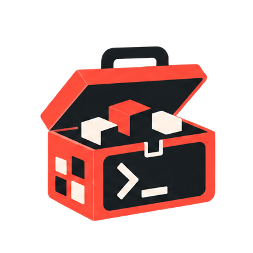

<!-- MAINTAINER:README_HEAD:START -->
<div id="maintainer-title" align="center">
    
    <h1>Artisan Toolbox documentation</h1>
</div>

<p id="maintainer-badges" align="center">
<a href="https://github.com/artisan-toolbox/docs/releases"></a>
<a href="https://github.com/artisan-toolbox/docs/blob/1.x/README.md"></a>
<a href="https://github.com/artisan-toolbox/docs/blob/1.x/README.md"></a>
<a href="https://github.com/artisan-toolbox/docs/actions/workflows/tests.yml?query=branch%3A1.x"></a>
<a href="https://atb.dev.br"></a>
</p>

<p id="maintainer-description" align="center">
    A Laravel, Vue, and Inertia application for Artisan Toolbox documentation and package integration examples.
</p>

<p align="center">
    The application is under migration. The existing documentation remains published at <a href="https://atb.dev.br">atb.dev.br</a>.
</p>
<!-- MAINTAINER:README_HEAD:END -->

The development workspace uses local package routing. Run `composer distribution:check` before distributing a lock file, and read [standalone installation prerequisites](documentation/quality.md#prepare-standalone-installation) for public package availability and clean-checkout verification.

Install PHP dependencies before frontend dependencies:

```bash
composer install
npm ci
npm run build
```

For a fresh local environment, `composer setup` creates the environment file, generates its local application key, migrates the database, and builds frontend assets.
Start development with `composer dev`.
Open `/` for the landing page and `/docs` for the complete package and community documentation.
Run `php artisan docs:search:index --no-interaction` after content changes and before activating a release. See [search maintenance](documentation/search.md) for prerequisites, deployment order, and freshness checks.

Run `composer ci:check` for the Rector dry run and Maintainer's PHP and frontend checks.
Use `composer quality:fix` to open the fixing workflow.
The application requires PHP 8.5. Asset builds and CI require Node.js 24.11 or newer. Quality checks require Composer development dependencies.
Vue SSR is disabled. Production does not need an Inertia SSR service.

Read [the quality workflow](documentation/quality.md), [the authoring workflow](documentation/authoring.md), [the architecture](documentation/architecture.md), [asset maintenance](documentation/assets.md), and [the migration plan](documentation/migration.md) before adding content.
Use [the named-route workflow](documentation/routing.md) for frontend URLs. Laravel supplies Ziggy's native configuration without a frontend route-generation step.

Follow [the package skill guide](documentation/package-skills.md) when adding or updating agent guidance shipped with a package. Keep skills, behavior tests, guides, and changelogs synchronized with public API and workflow changes.

The repository includes versioned [shared agent standards](documentation/agent-standards.md) for documentation and package development. Run `npm run standards:check` to verify the installed copies against their owning source.
